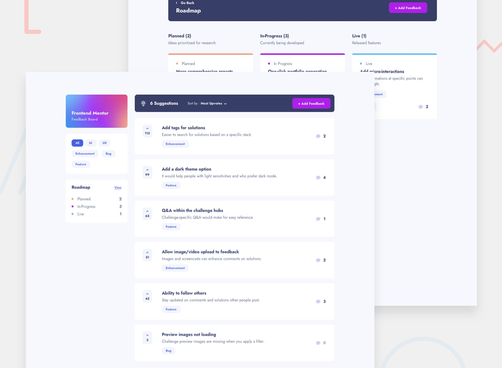

# Frontend Mentor - Product Feedback App solution

This is a solution to the [Product feedback app challenge on Frontend Mentor](https://www.frontendmentor.io/challenges/product-feedback-app-wbvUYqjR6). Frontend Mentor challenges help you improve your coding skills by building realistic projects.



## Table of contents

- [Overview](#overview)
  - [The challenge](#the-challenge)
  - [Links](#links)
- [My process](#my-process)
  - [Built with](#built-with)
  - [What I learned](#what-i-learned)
  - [Continued development](#continued-development)
- [Running locally](#running-locally)
  - [Scripts](#scripts)
  - [Testing](#testing)
  - [Routes](#routes)
- [Author](#author)

## Overview

### The challenge

Users should be able to:

- View the optimal layout for the app depending on their device's screen size
- See hover states for all interactive elements on the page
- Create, read, update, and delete product feedback requests
- Receive form validations when trying to create/edit feedback requests
- Sort suggestions by most/least upvotes and most/least comments
- Filter suggestions by category
- Add comments and replies to a product feedback request
- Upvote product feedback requests
- **Bonus**: Keep track of any changes, even after refreshing the browser (`localStorage` could be used for this if you're not building out a full-stack app)

I built it as a full-stack app, so every change is saved to a Postgres database.

There is no authentication by design. Every action runs as a hard-coded "Demo User", and `pnpm db:seed` resets the demo data.

### Links

- [Frontend Mentor - solution URL](https://www.frontendmentor.io/solutions/your-solution-url)
- [Live site](https://product-feedback-app-rho-nine.vercel.app)

## My process

### Built with

- Mobile-first workflow
- Semantic HTML and accessible, keyboard-friendly components
- [Next.js 16](https://nextjs.org/) - React framework (App Router, Server Components, Server Actions, Cache Components)
- [React 19](https://react.dev/) - JS library
- [TypeScript](https://www.typescriptlang.org/) - type safety
- [Tailwind CSS v4](https://tailwindcss.com/) - for styles
- [Neon](https://neon.tech/) Postgres with [Drizzle ORM](https://orm.drizzle.team/) - database
- [Zod](https://zod.dev/) - form validation in the browser and on the server
- [Vitest](https://vitest.dev/), [Playwright](https://playwright.dev/) and [axe](https://github.com/dequelabs/axe-core-npm) - unit, end-to-end and accessibility tests
- [Vercel](https://vercel.com/) - hosting

### What I learned

This was my first full-stack project.

- **Backend in Next.js** with Server Actions, form validation on both the browser and the server
- **Database** in Postgres: tables, relations and enums, defined with Drizzle ORM
- **SQL** for reads and writes, including keeping a vote and its counter in sync
- **Cache data** and refresh it after each change, so users see their updates right away

### Continued development

- Real authentication, so feedback and comments have owners and only they can edit them
- An admin role for changing a feedback's status

## Running locally

Requires Node 22.18+ and pnpm.

```bash
pnpm install
pnpm dlx vercel link             # link to the Vercel project
pnpm dlx vercel env pull .env.local  # fetch DATABASE_URL
pnpm db:push                     # create tables
pnpm db:seed                     # load sample data
pnpm dev
```

### Scripts

| Script              | Description                           |
| ------------------- | ------------------------------------- |
| `pnpm dev`          | Start the dev server                  |
| `pnpm build`        | Production build                      |
| `pnpm lint`         | Run ESLint                            |
| `pnpm format`       | Format with Prettier                  |
| `pnpm format:check` | Check formatting                      |
| `pnpm test`         | Run unit tests                        |
| `pnpm test:watch`   | Run unit tests in watch mode          |
| `pnpm test:e2e`     | Run end-to-end tests                  |
| `pnpm db:push`      | Apply `db/schema.ts` to the database  |
| `pnpm db:seed`      | Reset the database to the sample data |
| `pnpm db:studio`    | Browse the database in Drizzle Studio |

### Testing

| Layer      | Tool                         | Covers                                                                                                          |
| ---------- | ---------------------------- | --------------------------------------------------------------------------------------------------------------- |
| Unit       | Vitest                       | Validation schemas and URL parsing in `lib/`                                                                    |
| End-to-end | Playwright                   | Filtering, sorting, create/edit/delete, comments and replies, upvotes, the mobile drawer and roadmap tabs       |
| A11y       | axe (`@axe-core/playwright`) | Automated checks on the main pages                                                                              |
| CI         | GitHub Actions               | Lint, typecheck, formatting and unit tests on every push; end-to-end tests when the test database secret is set |

### Routes

| Route                 | Page                          |
| --------------------- | ----------------------------- |
| `/`                   | Suggestions (sort and filter) |
| `/roadmap`            | Roadmap                       |
| `/feedback/new`       | Create feedback               |
| `/feedback/[id]`      | Feedback detail and comments  |
| `/feedback/[id]/edit` | Edit feedback                 |

## Author

- Frontend Mentor - [@stfnpczk](https://www.frontendmentor.io/profile/stfnpczk)
- GitHub - [@stfnpczk](https://github.com/stfnpczk)
